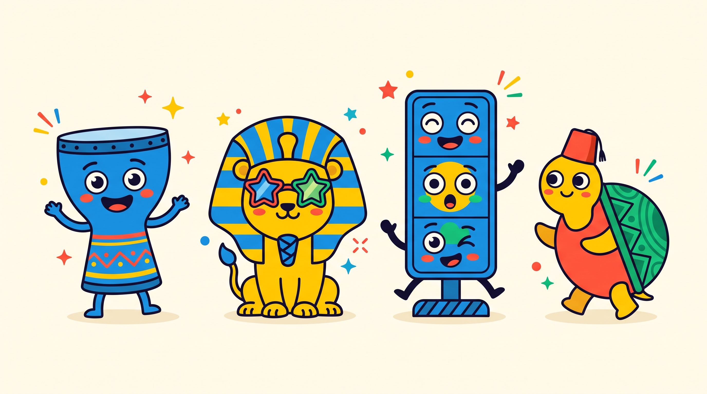

<div align="center">

# فركش · Farkash

### الموبايل اللي طفلك بيحبه، مساحة للّعب والتعلّم مع بعض.

ألعاب مصرية تفاعلية تجمع الحركة والانتباه والانتظار والتنفس الهادئ، بتجربة عربية وإنجليزية على الموبايل والكمبيوتر.

[**جرّب فركش الآن**](https://farkash.vercel.app) · [الألعاب](#الألعاب-الست) · [التشغيل محليًا](#التشغيل-محليًا) · [الملاحظات والاقتراحات](https://github.com/Omarhussien2/farkash/issues)




</div>

<div dir="rtl">

## لماذا فركش؟

«استنى دورك»، «ركّز في التعليمات»، «اهدأ وخد نفس». فركش يحوّل هذه الطلبات إلى مواقف لعب واضحة يمكن للطفل تجربتها: ينتظر اللون الصحيح، يتوقف مع الموسيقى، أو يتبع إيقاع التنفس.

تبدأ الفكرة من شيء الطفل يحبه بالفعل: الموبايل. الشاشة تقدّم الإشارة، والطفل يشارك بالحركة أو الاختيار أو التنفس، ومعه أحد الوالدين أو المربي. وفي ألعاب الحركة، يمكن استخدام هاتف واحد لإدارة اللعب الجماعي.

الهدف هو توفير فرص متكررة للتدرّب على مهارات محددة، مع تعليمات عربية مصرية وشخصيات قريبة من روح اللعبة. يستطيع الأهل مشاهدة ما حدث خلال الجلسات من خلال تقرير التقدم.

## كيف تصبح المهارة لعبة؟

| الموقف داخل اللعبة | ما يتدرّب عليه الطفل |
| --- | --- |
| الموسيقى تتوقف، فيحاول الثبات أو الجلوس | ملاحظة الإشارة وإيقاف الحركة |
| لون يظهر، لكن الأمر الصوتي يغيّر الاستجابة المطلوبة | الاستماع للتعليمات قبل التصرف |
| البطارية تشحن، وتظهر ألوان خادعة قبل الأخضر | الانتظار ومقاومة الضغط المبكر |
| الكارت يقول «اجري»، والمطلوب تنفيذ العكس | تبديل القاعدة والمرونة في الاستجابة |
| السلحفاة تكبر وتصغر مع مراحل التنفس | اتباع إيقاع هادئ للشهيق والزفير |

## الألعاب الست

| اللعبة | ماذا يحدث؟ | مسار اللعب |
| --- | --- | --- |
| **كراسينا · Smart Chairs** | كراسي موسيقية بتوقف عشوائي، مع ضبط عدد اللاعبين والمدة، وإمكانية رفع أغنية من الجهاز. | الحركة الجماعية |
| **تماثيل إسكندرية · Freeze Poses** | تتوقف الموسيقى وتظهر وضعية مصرية، منها أبو الهول وبياع العرقسوس ورمسيس بصور الشخصيات؛ يؤكد اللاعب الثبات ثم يبدأ عدّ مدة الاحتفاظ بالوضعية. | الحركة الجماعية |
| **إشارة شبرا · Shubra Lights** | إشارات مرور مع قاعدة «قال السلطان»: الاستجابة تعتمد على الإشارة والأمر معًا. | الحركة الجماعية |
| **العكس بالعكس · Reverse Logic** | عشرة كروت بصور المكعب في حالتي الجري والتوقف، وعلى اللاعب اختيار عكس الأمر المعروض مع تجاهل اللون المشتت. | التركيز وكبح الاندفاع |
| **تحدي الصبر واللون · Patience & Color** | انتظار الشحن، ثم الضغط عند ظهور الأخضر وتجاهل ألوان الفخ. | التركيز وكبح الاندفاع |
| **نَفَس الزحلفاوي · Turtle Breath** | أربع جولات؛ كل جولة تشمل شهيقًا ٤ ثوانٍ، وثباتًا ثانيتين، وزفيرًا ٦ ثوانٍ، ثم راحة قصيرة. | ركن الهدوء |

## جرّبه مع طفلك

1. افتح [التطبيق](https://farkash.vercel.app) واختارا لعبة معًا. لا يلزم إنشاء حساب.
2. اشرح القاعدة، واترك للطفل فرصة لتجربتها قبل التركيز على النتيجة.
3. في ألعاب الحركة، جهّز مساحة مناسبة، وليتولَّ شخص بالغ إدارة الهاتف عند الحاجة.
4. جرّبا مرة أخرى، أو انتقلا إلى ركن الهدوء بحسب رغبة الطفل.
5. افتح **تقرير البطل** لمراجعة الجلسات المسجلة خلال آخر سبعة أيام.

يمكن تثبيت نسخة الويب من قائمة المتصفح عندما يكون خيار التثبيت متاحًا. تظل اللعبة متاحة أيضًا من الرابط مباشرة.

## تقرير البطل

يعرض التقرير محاولات اللعب الحقيقي خلال آخر سبعة أيام، وأيام الممارسة، والثواني المسجّلة للانتظار والهدوء، مع اقتراح عملي للمحاولة القادمة وزر لفتح اللعبة المناسبة.

- أزمنة ألعاب الحركة تعتمد على **لمسة تأكيد اللاعب**؛ لا يستخدم التطبيق كاميرا أو مستشعرًا لقياس الحركة.
- بعد اكتمال **٦ محاولات حقيقية في اللعبة نفسها**، يقارن أول ثلاث بآخر ثلاث عبر السجل كله: متوسط النتيجة من ١٠٠ ومتوسط الأخطاء لكل محاولة. المجموعتان منفصلتان، ولا تُقارن درجات ألعاب مختلفة.
- حدّ المقارنة شرط حسابي لتكوين مجموعتين، وليس معيارًا طبيًا. تغيير إعدادات اللعبة أو المساعدة أو ظروف اللعب قد يؤثر في النتائج.
- التنفس يُسجّل كنشاط مكتمل؛ نتيجته لا تقيس هدوء الطفل أو حالته النفسية.
- **البيانات التجريبية منفصلة** في عرض اختياري؛ لا تدخل في إحصاءات اللعب الحقيقي أو المقارنات الشخصية.
- السجل موحّد على الجهاز، ولا توجد ملفات منفصلة للأطفال. مشاركة الجهاز أو اللعب الجماعي يدمج النتائج؛ لا يمكن نسبتها لطفل واحد.

فركش مصمم لدعم التدريب من خلال اللعب. لا توجد في هذا المستودع دراسة سريرية تقيس أثره العلاجي.

## مكتبة أولياء الأمور

تضم [المكتبة](https://farkash.vercel.app/articles/) أربعة أدلة عربية عن العصبية، والاندفاع، والصبر وانتظار الدور، والتركيز والاستماع. كل دليل يتضمن أنشطة منزلية وأسئلة شائعة وروابط للمصادر ولعبة مرتبطة بالموضوع. الخلفية العامة تستند إلى مصادر من الأكاديمية الأمريكية لطب الأطفال، وCDC، ومركز نمو الطفل بجامعة هارفارد؛ لا يعني ذلك اعتماد هذه الجهات للتطبيق.

المقالات صفحات HTML مستقلة تُقرأ بدون JavaScript، مع عناوين وأوصاف فريدة، وروابط أساسية `canonical`، وبيانات منظمة `Article` و`FAQPage` و`BreadcrumbList`، وروابط داخلية، وملفّي `sitemap.xml` و`robots.txt`. تهيئة الفهرسة لا تضمن ترتيبًا معينًا أو ظهور نتائج بحث محسّنة.

المحتوى محفوظ في `src/content/articles.json`. يولّد `scripts/build-library.mjs` الصفحات تلقائيًا قبل `npm run dev` و`npm run build`، ويمكن تشغيله مباشرة بأمر `npm run library`. المخرجات داخل `public/articles/` وملفّا خريطة الموقع والروبوتات مولّدة ولا تُحفظ في Git. عند تعديل المحتوى أثناء تشغيل خادم التطوير، أعد تشغيل `npm run library` لتحديث الصفحات.

## تجربة مناسبة للاستخدام اليومي

- **العربية والإنجليزية:** تبديل اللغة مع دعم اتجاه الكتابة من اليمين إلى اليسار.
- **تصميم متجاوب:** مكتبة ألعاب تتكيف مع الهاتف والتابلت والشاشات الكبيرة.
- **أوامر مسموعة:** تسجيلات متاحة، ثم خيارات نطق بديلة حسب الإعدادات والمتصفح.
- **تحكم في الصوت:** تشغيل الموسيقى والأصوات أو إيقافها، والتحكم بالنطق بشكل مستقل.
- **صور لكل لعبة:** شخصيات واضحة، وبانر يجمع أصحاب فركش، وزخارف مستمدة من الهوية البصرية.
- **إتاحة أفضل:** أزرار قابلة للاستخدام بلوحة المفاتيح، ومؤشرات تركيز واضحة، ودعم تقليل الحركة والتكبير.

## البيانات والخصوصية

إعدادات اللغة والصوت وسجل اللعب محفوظة في متصفح الجهاز باستخدام `localStorage`. البيانات مستقلة بين الأجهزة والمتصفحات؛ لا توجد مزامنة سحابية أو حسابات مستخدمين في النسخة الحالية. مسح بيانات الموقع من المتصفح يزيل السجل المحلي، وإعادة بيانات التجربة من الإعدادات تستبدله بعد التأكيد.

النطق عبر **ElevenLabs** اختياري. إذا أضفت مفتاحًا في الإعدادات، يُحفظ على الجهاز ويُرسل مباشرة إلى ElevenLabs عند طلب توليد الصوت. من دون المفتاح، يستخدم التطبيق التسجيلات المتاحة أو نطق المتصفح. لا تضع المفاتيح في ملفات المصدر أو في المستودع.

يجهّز التطبيق ملفات الواجهة والتسجيلات والهوية الأساسية للاستخدام دون اتصال بعد اكتمال التخزين المؤقت في نسخة الإنتاج. تُخزّن صور الألعاب عندما تُعرض، بينما يحتاج توليد صوت جديد عبر خدمة خارجية إلى اتصال.

## التشغيل محليًا

المتطلبات: **Node.js 24 LTS** وnpm.

<div dir="ltr">

```bash
git clone https://github.com/Omarhussien2/farkash.git
cd farkash
npm ci
npm run dev
```

</div>

افتح العنوان الذي يظهر في الطرفية. لا تحتاج النسخة الحالية إلى ملف `.env` لتشغيل الألعاب أو التقرير المحلي.

### أوامر التحقق والبناء

<div dir="ltr">

```bash
npm test
npm run typecheck
npm run lint
npm run build
npm run preview
```

</div>

| الأمر | الغرض |
| --- | --- |
| `npm test` | تشغيل اختبارات الانحدار لحفظ الجلسات، وإكمال التنفس، وقفل الإجابات، وحساب التقرير. |
| `npm run typecheck` | فحص أنواع TypeScript. |
| `npm run lint` | فحص قواعد ESLint. |
| `npm run build` | إنتاج نسخة النشر داخل `dist/`. |
| `npm run preview` | معاينة النسخة المبنية محليًا. |

اختبر التخزين المؤقت وService Worker باستخدام نسخة الإنتاج؛ هذه الميزة معطلة أثناء التطوير.

## بنية المشروع

<div dir="ltr">

```text
src/
├── components/       # الرئيسية، التقرير، الإعدادات، وعناصر الواجهة المشتركة
├── games/            # منطق الألعاب الست وشاشاتها
├── hooks/            # تسجيل نتيجة كل جلسة مرة واحدة
├── store/            # حالة التطبيق والإعدادات والحفظ المحلي
├── utils/            # الصوت والنطق والترجمة وحساب التقرير
├── brand.ts          # مسارات البانر والزخارف وصور الألعاب
└── types.ts          # تعريف الألعاب والمسارات والبيانات
public/
├── images/           # الصور الأصلية للهوية والألعاب
└── audio/            # التسجيلات الصوتية المتاحة
supabase/migrations/  # ترحيلات النسخة القديمة وإغلاق الوصول العام
```

</div>

التطبيق مبني باستخدام React وTypeScript وVite، مع Tailwind CSS وFramer Motion وLucide، ويستخدم Vitest وTesting Library لاختبارات الانحدار.

## النشر والتحديث

النسخة المنشورة: **[farkash.vercel.app](https://farkash.vercel.app)**.

المستودع مرتبط بمشروع Vercel؛ دفع تحديثات إلى فرع `main` يطلق نشرًا جديدًا تلقائيًا. إعدادات البناء موجودة في `vercel.json`، مع استبعاد ملفات البيئة والبيانات المحلية وملفات التطوير عبر `.vercelignore`. تُنتَج ملفات الموقع داخل `dist/`.

بعد ربط المشروع بحساب Vercel، يمكن النشر من الطرفية:

<div dir="ltr">

```bash
vercel deploy --prod
```

</div>

### لمن يستخدم قاعدة Supabase من نسخة سابقة

النسخة الحالية لا ترسل جلسات اللعب إلى Supabase. لو سبق تشغيل ترحيل الجدول العام، طبّق الترحيل التالي عبر سير عمل قاعدة البيانات لديك لإغلاق سياسات الوصول القديمة:

<div dir="ltr">

```text
supabase/migrations/20261018190000_lock_unauthenticated_sessions.sql
```

</div>

لم يُطبَّق هذا الترحيل على قاعدة بيانات خارجية ضمن تجهيز النسخة المنشورة. التفاصيل الفنية والإصلاحات موثقة في [تقرير المراجعة](REVIEW.md).

## تطوير الفكرة

اقتراحات الألعاب، وتحسين التعليمات العربية، وملاحظات استخدام الأطفال والأهل مرحب بها في [Issues](https://github.com/Omarhussien2/farkash/issues). عند الإبلاغ عن مشكلة، اذكر المتصفح والجهاز والخطوات التي أدت إليها، وتجنب مشاركة بيانات شخصية تخص طفلًا.

</div>

---

### English overview

**Farkash** is an Arabic/English web app with six Egyptian-themed games for practising attention, waiting, response inhibition, movement, and paced breathing. It uses a familiar mobile screen to guide play with a parent or educator. Play history stays in the current browser. The report separates sample data and compares the first three with the latest three real attempts within each game after six completed attempts; breathing completion is not a measure of emotional improvement. Shared play combines results in one history. Four crawlable Arabic parent guides cover anger, impulsivity, patience and focus. Built with React, TypeScript, Vite, and Tailwind CSS, with PWA support and regression tests.

[Try the app](https://farkash.vercel.app) · [Report an issue](https://github.com/Omarhussien2/farkash/issues)
